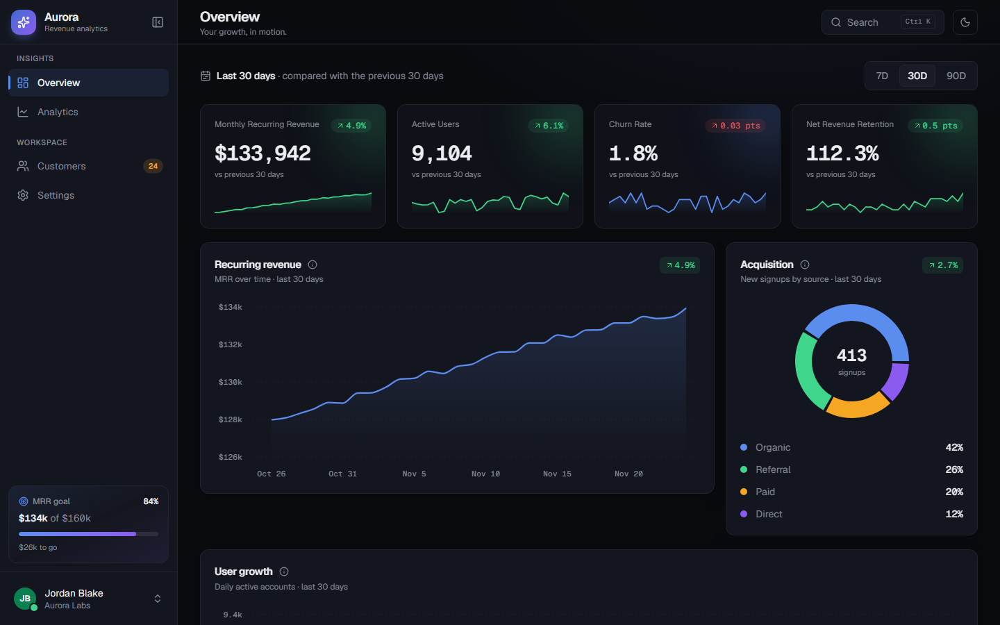
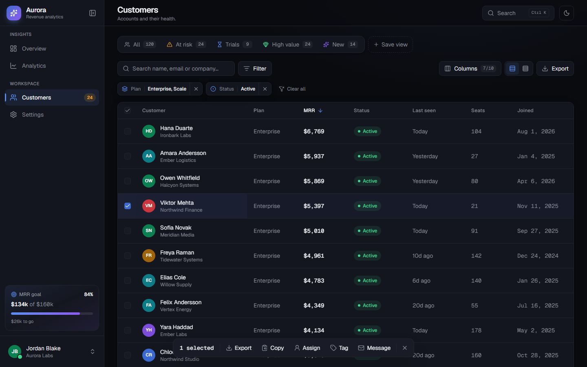
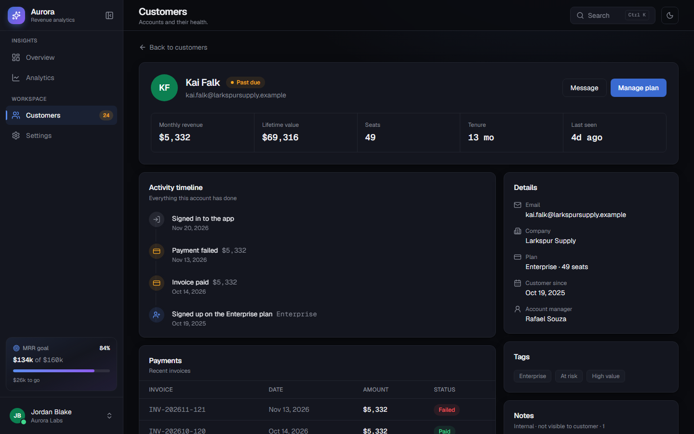
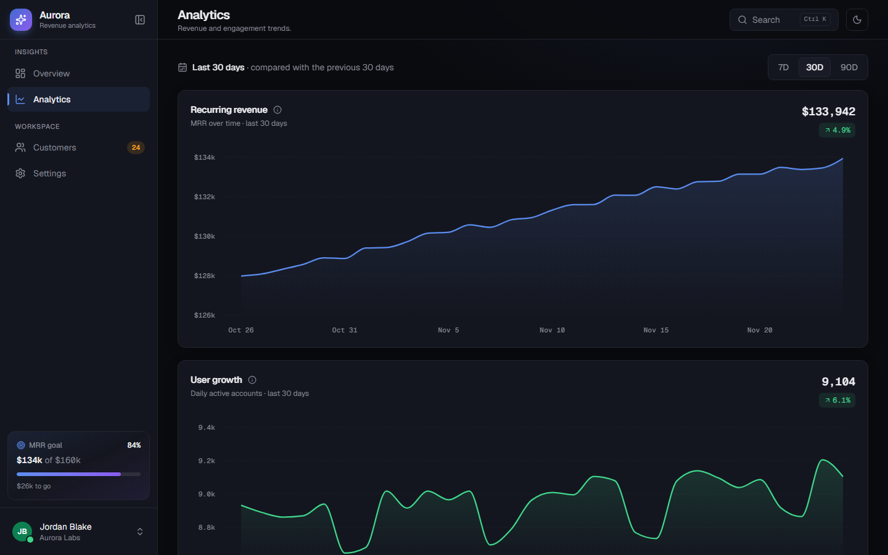
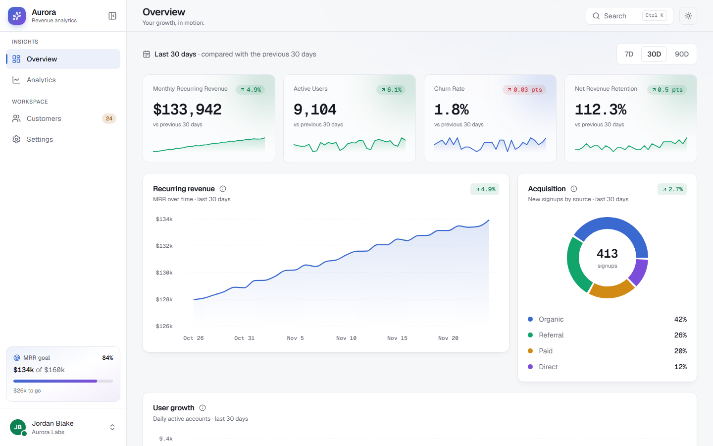
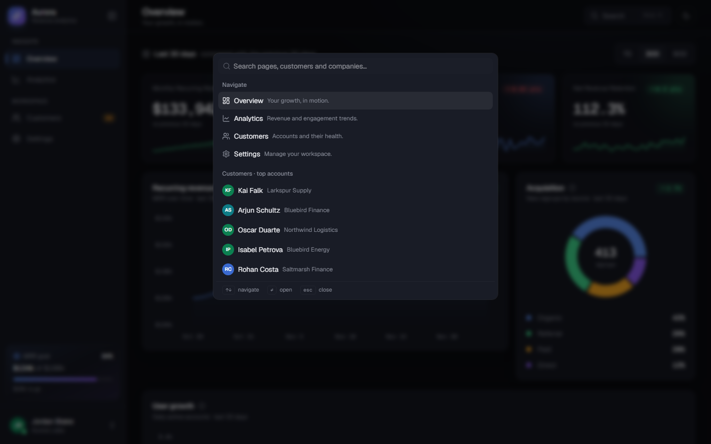
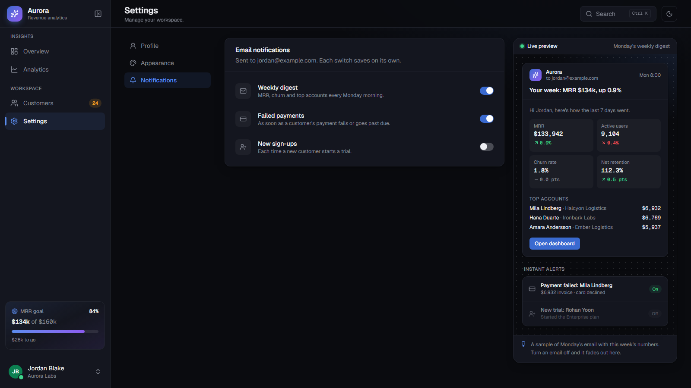
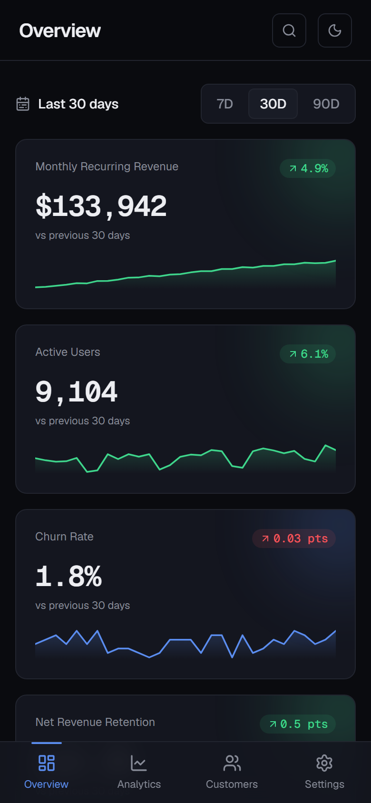
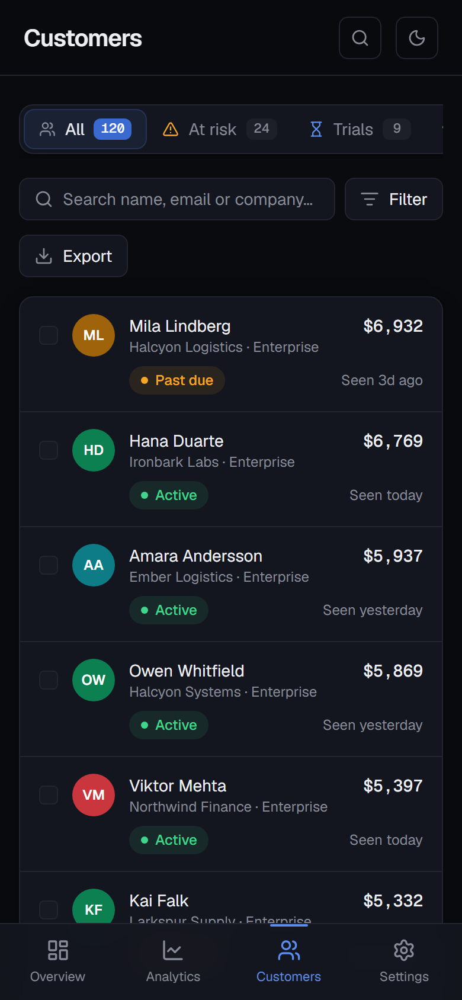
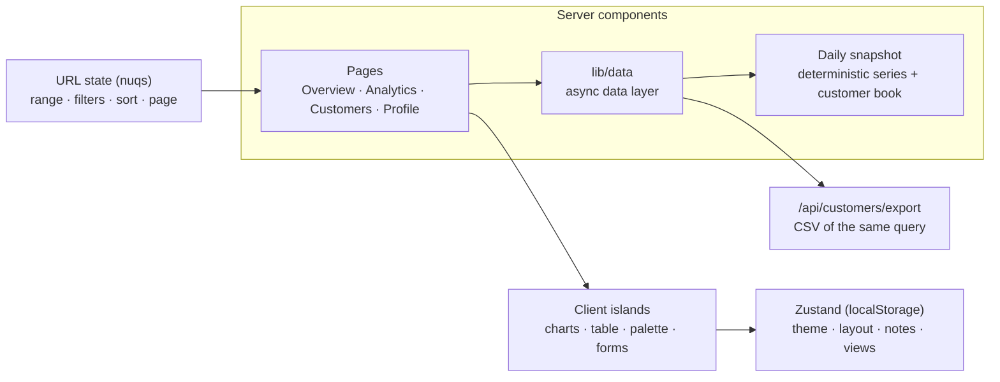

# Aurora: revenue analytics for SaaS teams

[](https://github.com/menaka809/aurora/actions/workflows/ci.yml)

A polished SaaS analytics dashboard: revenue KPIs, interactive charts, and a CRM-grade customers table with filters, saved views, bulk actions and print/CSV export. Built with Next.js 16 and React 19.

**[Open the live demo →](https://aurora-nine-drab-75.vercel.app/)**. No sign-in needed. Your edits are saved in your own browser.



## Highlights

### Dashboards
- **KPI cards** for MRR, active users, churn and NRR. Each has a sparkline and a "vs previous period" change, and the numbers count up when they change.
- **One global date range** (7, 30 or 90 days) in the top bar. It's kept in the URL, so every view can be shared.
- **Charts:** recurring revenue, user growth, acquisition channels, conversion funnel, revenue by plan, and progress towards the MRR goal.
- **Every number agrees with every other number.** All figures come from a single daily snapshot, so the KPIs, charts, plan breakdown and customer list always add up. The data rolls forward each day and always ends today.

### Customers
- **Filter chips** for plan, status, MRR, seats, last seen, join date and account health. Each option shows a live count.
- **Saved views:** built-in tabs (All, At risk, Trials, High value, New) plus your own.
- **Columns:** drag to reorder, resize, show or hide. There are two row densities, and your layout is remembered.
- **Bulk actions:** select one page or every match, then export, copy, assign a manager, tag, or message.
- **Quick-view drawer** from any row, and a full profile page with timeline, invoices, tickets, notes and plan changes.
- **Print-ready report** and **CSV export** of exactly what's filtered.
- **On phones** the table becomes a card list.

### Experience
- **⌘K / Ctrl K command palette** for pages, customers and actions.
- **Dark, light and system themes**, a collapsible sidebar (press `[`), and a settings page with live previews.
- **Accessibility:** WCAG AA contrast, full keyboard use, screen-reader labels, and reduced-motion support.
- **Loading skeletons, empty states, error boundaries and a branded 404.**
- **SEO:** per-page titles, Open Graph share image with live KPIs, sitemap and robots.

## Screenshots

| Customers | Customer profile |
|---|---|
|  |  |
| **Analytics** | **Light theme** |
|  |  |
| **Command palette** | **Settings** |
|  |  |

<p>
  
  
</p>

## Tech stack

| Area | Tools |
|---|---|
| Framework | Next.js 16 (App Router, server components), React 19, TypeScript |
| Styling | Tailwind CSS v4, shadcn/ui on Radix primitives, Framer Motion |
| Data table | TanStack Table v9, dnd-kit (column reordering) |
| Charts | Recharts 3 (lazy-loaded), hand-built SVG sparklines and goal ring |
| State | nuqs (URL state), Zustand (persisted preferences) |
| Forms | React Hook Form + Zod |
| Tooling | ESLint, GitHub Actions CI (typecheck, lint, build), Vercel |

## Architecture



- **Pages are server components.** They read the URL, call `lib/data`, and send ready-made HTML. Only interactive parts (charts, table, palette, forms) hydrate as small client islands.
- **`lib/data` is the only data entry point.** Every function is async and returns typed data, so a real database can replace the internals without changing a single page.
- **Filtering, sorting and paging run on the server** from the URL (`/customers?plan=Enterprise&status=past_due`). Every view can be bookmarked and shared, and CSV export reuses the same query.
- **Deterministic data:** each day's metrics come from a seeded function of that date. The window always ends today, while past days never change.
- **Charts are code-split** into one lazily loaded chunk and only render when scrolled into view.

## Project structure

```
app/
  (dashboard)/        Overview, Analytics, Customers, Profile, Settings (+ loading/error states)
  api/customers/      CSV export route
  print/customers/    Print-ready customer report
  opengraph-image.tsx Share image with live KPIs
components/
  views/              Server-rendered dashboard pages
  customers/          Data table, filters, views, bulk bar, quick view
  charts/             Lazy chart bundle and sparklines
  settings/           Settings sections
  ui/                 shadcn/ui primitives
lib/
  data/               Async data layer (the single source of truth)
  customers-query.ts  URL parsers + filter/sort/page logic
  metrics.ts          Deterministic daily metrics
```

## Run locally

Requires Node.js 22+.

```bash
npm ci
npm run dev        # http://localhost:3000
```

| Script | What it does |
|---|---|
| `npm run dev` | Start the dev server |
| `npm run build` | Production build |
| `npm run start` | Serve the production build |
| `npm run typecheck` | TypeScript check |
| `npm run lint` | ESLint |

Optional: set `DEMO_LATENCY_MS=400` to simulate a slow API and see the loading skeletons.

## About

Designed and built by **Malith**, a freelance Next.js / React developer.
